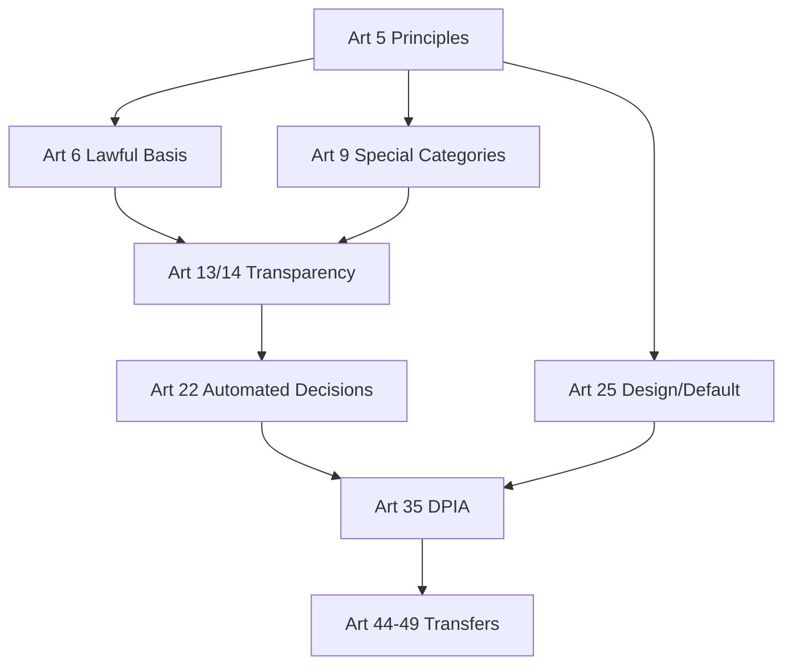

---
tags:
 - aigp/reference
 - aigp/legal
 - aigp/privacy
aliases:
 - GDPR AI Provisions
 - EU GDPR AI Articles
created: 2026-07-11
source: Regulation (EU) 2016/679 (General Data Protection Regulation)
wikilinks:
 - "[[AIGP Body of Knowledge — Exam Blueprint]]"
 - "[[Privacy and Data Protection Law]]"
---

# GDPR — AI-Relevant Provisions

> **Regulation (EU) 2016/679** — the EU's comprehensive data protection framework. Many of its core provisions directly govern AI systems that process personal data.

---

## Overview of AI-Relevant Articles

| Article | Topic | AI Relevance |
|:--------|:------|:-------------|
| [[#Art 5 — Principles]] | Data protection principles | Foundation for all AI data processing |
| [[#Art 6 — Lawfulness of Processing]] | Legal bases | Validating the legal basis for AI training/inference |
| [[#Art 9 — Special Categories]] | Sensitive data (biometrics, health) | **Critical** — AI often processes biometrics, inferred health data |
| [[#Art 13 — Transparency (Direct Collection)]] | Notice obligations | Explainability of AI to data subjects |
| [[#Art 14 — Transparency (Indirect Collection)]] | Notice when data not from subject | LLM training data, web-scraped datasets |
| [[#Art 15 — Right of Access]] | Data subject access | Disclosure of AI logic and profiling |
| [[#Art 17 — Right to Erasure]] | Right to be forgotten | Machine unlearning, model deletion challenges |
| [[#Art 22 — Automated Decision-Making]] | **Most important for AI** | Prohibition on solely automated decisions |
| [[#Art 25 — Data Protection by Design/Default]] | Privacy by design | Embedding privacy into AI system architecture |
| [[#Art 28 — Processor Obligations]] | Processor contracts | AI-as-a-service, cloud AI providers |
| [[#Art 35 — DPIA]] | Data Protection Impact Assessment | Mandatory for high-risk AI systems |
| [[#Arts 44–49 — Cross-Border Transfers]] | International data transfers | AI cloud infrastructure, global model deployment |

---

## Art 5 — Principles Relating to Processing of Personal Data

### Key Provisions

1. **Lawfulness, fairness, and transparency** (Art 5(1)(a)): Personal data must be processed lawfully, fairly, and in a transparent manner.
2. **Purpose limitation** (Art 5(1)(b)): Data collected for specified, explicit, and legitimate purposes; no incompatible further processing.
3. **Data minimisation** (Art 5(1)(c)): Adequate, relevant, and limited to what is necessary.
4. **Accuracy** (Art 5(1)(d)): Data must be accurate and kept up to date; inaccurate data erased or rectified without delay.
5. **Storage limitation** (Art 5(1)(e)): Kept no longer than necessary; exceptions for archiving, research, statistics (Art 89(1)).
6. **Integrity and confidentiality** (Art 5(1)(f)): Appropriate security measures against unauthorised/unlawful processing, loss, destruction, damage.
7. **Accountability** (Art 5(2)): The controller is responsible for and must demonstrate compliance.

### AI Implications

> [!warning] Data Minimisation vs. AI
> AI systems — especially deep learning — are data-hungry by design. The principle of **data minimisation** creates inherent tension with model training that benefits from more data. Organisations must document why the volume and variety of data is *necessary* for the specific purpose.

- **Purpose limitation** constrains repurposing training data for new AI models without a compatibility assessment (Art 6(4)).
- **Accuracy** is especially challenging for AI outputs: if an AI generates inaccurate inferences about a data subject (e.g., predicted credit score, inferred health status), these must be correctable.
- **Accountability** means AI developers must maintain auditable records of data provenance, training methodology, and compliance measures.

---

## Art 6 — Lawfulness of Processing

### Key Provisions

Processing is lawful only if **at least one** of the following applies:

| Basis | Description |
|:------|:------------|
| (a) Consent | Data subject has given consent for specific purposes |
| (b) Contract | Necessary for performance of a contract |
| (c) Legal obligation | Necessary for compliance with a legal obligation |
| (d) Vital interests | Necessary to protect vital interests |
| (e) Public interest | Necessary for a task in the public interest / official authority |
| (f) Legitimate interests | Necessary for legitimate interests pursued by controller or third party (except where overridden by data subject's rights) |

Art 6(4): Further processing for a new purpose requires a **compatibility assessment** considering: links between purposes, context, nature of data, consequences for data subjects, and safeguards.

### AI Implications

> [!important] Legitimate Interests & AI Training
> Many AI developers rely on **legitimate interests** (Art 6(1)(f)) as the legal basis for training models on personal data. This requires a **Legitimate Interests Assessment (LIA)** balancing the developer's commercial interest against the privacy rights of data subjects. The EDPB has increasingly scrutinised this basis for large-scale AI training.

- **Consent** must be freely given, specific, informed, and unambiguous (Art 7) — difficult to obtain at scale for AI training.
- **Contract necessity** is narrowly interpreted; AI profiling for marketing purposes generally does not qualify.
- **Repurposing data** (Art 6(4)): Training a new AI model on data originally collected for a different purpose requires careful compatibility analysis.

---

## Art 9 — Processing of Special Categories of Personal Data

### Key Provisions

**General prohibition** (Art 9(1)): Processing of the following is **prohibited**:

- Racial or ethnic origin
- Political opinions
- Religious or philosophical beliefs
- Trade union membership
- **Genetic data**
- **Biometric data** for uniquely identifying a natural person
- **Data concerning health**
- Data concerning sex life or sexual orientation

**Exceptions** (Art 9(2)) — processing permitted where:

| Exception | Description |
|:----------|:------------|
| (a) | **Explicit consent** |
| (b) | Employment / social security / social protection law |
| (c) | Vital interests (data subject incapable of consent) |
| (d) | Not-for-profit bodies (political, philosophical, religious, trade union) |
| (e) | Data **manifestly made public** by the data subject |
| (f) | Legal claims / judicial capacity |
| (g) | **Substantial public interest** (Union/Member State law basis) |
| (h) | Preventive/occupational medicine, medical diagnosis, health/social care |
| (i) | **Public health** (cross-border threats, quality/safety of healthcare) |
| (j) | Archiving, scientific/historical research, statistics (Art 89(1)) |

Art 9(4): Member States may introduce further conditions on genetic, biometric, and health data.

### AI Implications

> [!danger] Biometric & Health Inferences
> This is arguably the **single most important GDPR article for AI governance**. AI systems routinely:
> - **Infer** special category data from non-special category inputs (e.g., inferring health conditions from shopping patterns, inferring ethnicity from facial images).
> - Process **biometric data** for facial recognition, emotion detection, voice analysis.
> - Generate **health-related predictions** (diagnostic AI, wellness apps).
>
> The EDPB and supervisory authorities increasingly treat **inferred** special category data as falling within Art 9(1), even if the raw input data is not special category.

- **Facial recognition systems** process biometric data → Art 9 prohibition applies unless explicit consent or substantial public interest (with Member State law basis).
- **AI-driven health apps and diagnostic tools** must satisfy Art 9(2)(h) conditions (health professional involvement, professional secrecy).
- **Emotion recognition AI** that infers mental/emotional state → likely triggers Art 9 concerns.
- **Web-scraped training data** may inadvertently contain special category data; reliance on "manifestly made public" (Art 9(2)(e)) is risky and increasingly challenged.

---

## Art 13 — Information to Be Provided Where Personal Data Are Collected from the Data Subject

### Key Provisions

Controllers must provide at the time of collection:

1. **Basic information** (Art 13(1)): Identity/contact of controller and DPO; purposes and legal basis; legitimate interests (if Art 6(1)(f)); recipients; international transfer details.

2. **Additional transparency** (Art 13(2)) — **critical for AI**:
 - Storage period or criteria
 - Data subject rights (access, rectification, erasure, restriction, portability, objection)
 - Right to withdraw consent
 - Right to lodge a complaint
 - Whether provision is statutory/contractual and consequences of failure to provide
 - **(f) The existence of automated decision-making, including profiling, referred to in Article 22(1) and (4) and, at least in those cases, meaningful information about the logic involved, as well as the significance and the envisaged consequences of such processing for the data subject.**

### AI Implications

> [!note] Meaningful Information About the Logic
> Art 13(2)(f) is the GDPR's core **explainability** requirement for AI. When AI systems make automated decisions or profile data subjects, the controller must provide:
> - **Meaningful information** about the logic involved (not the full algorithm, but a comprehensible explanation of how the system works and how it reaches decisions)
> - **Significance and envisaged consequences** — what the decision means for the data subject in practical terms
>
> This is not a right to full model disclosure, but a right to *functional explainability*.

- Privacy notices for AI products must explain profiling/automated processing in **clear, plain language**.
- This intersects with the **EU AI Act** transparency requirements for AI systems.

---

## Art 14 — Information to Be Provided Where Personal Data Have Not Been Obtained from the Data Subject

### Key Provisions

Where data is **not** collected directly from the data subject, the controller must provide:

- Same identity/contact information as Art 13
- **Categories of personal data concerned**
- Source of data (including publicly accessible sources)
- The same Art 13(2) additional information — including **automated decision-making disclosures**
- Must be provided: (a) within a reasonable period (max 1 month), (b) at first communication, or (c) before first disclosure to another recipient

**Exceptions** (Art 14(5)): where data subject already has information; impossible or disproportionate effort (with safeguards); legal obligation; professional secrecy.

### AI Implications

> [!warning] LLM Training & Web-Scraped Data
> Large language models and generative AI trained on **web-scraped data** typically process personal data not obtained from the data subject. Art 14 requires notifying individuals — but developers often invoke the **"disproportionate effort"** exception (Art 14(5)(b)). This exception is under intense regulatory scrutiny, particularly from EU DPAs investigating AI training practices.

- **Foundation model training** that scrapes public data must assess whether providing Art 14 notices to billions of data subjects is feasible.
- Even if invoking "disproportionate effort," controllers must implement **safeguards** including making information publicly available.
- **Synthetic data generation** derived from personal data may still trigger indirect collection obligations.

---

## Art 15 — Right of Access by the Data Subject

### Key Provisions

Data subjects have the right to:

1. **Confirmation** whether their personal data is being processed
2. **Access** to the personal data and:
 - Purposes, categories, recipients, storage period
 - Rights to rectification, erasure, restriction, objection
 - Right to lodge a complaint
 - Source of data (if not collected from subject)
 - **(h) The existence of automated decision-making, including profiling, referred to in Article 22(1) and (4) and meaningful information about the logic involved, as well as the significance and envisaged consequences**
 - Safeguards for international transfers (Art 46)

### AI Implications

> [!important] Access Requests & AI Models
> Art 15 presents unique challenges for AI systems:
> - Can a data subject access their **training data** embedded in model weights?
> - **Model inversion attacks** and **membership inference** complicate the line between personal data and model parameters.
> - The controller must provide **meaningful information about the logic** — this goes beyond what Art 13 requires at collection time; it obligates responsive disclosure on request.

- Data subjects can request the **logic of automated decisions** that affect them, including model type, input features, and relative weighting.
- This right works alongside **Art 22** to ensure accountability for AI-driven outcomes.

---

## Art 17 — Right to Erasure ("Right to Be Forgotten")

### Key Provisions

Data subjects can request erasure without undue delay where:

| Ground | Description |
|:-------|:------------|
| (a) | Data no longer necessary for original purpose |
| (b) | Consent withdrawn, no other legal ground |
| (c) | Objection under Art 21(1) — no overriding grounds |
| (d) | Unlawful processing |
| (e) | Legal obligation to erase |
| (f) | Data collected from child (information society services) |

**Exceptions** (Art 17(3)): freedom of expression, legal obligation, public health, archiving/research/statistics, legal claims.

Art 17(2): Where data made public, controller must take **reasonable steps** (including technical measures) to notify other processors.

### AI Implications

> [!danger] Machine Unlearning
> This is one of the **hardest technical challenges** at the intersection of GDPR and AI. Deleting an individual's data from a trained model is not straightforward:
> - **Full retraining** is computationally expensive and may be impractical for large foundation models.
> - **Approximate unlearning** techniques (e.g., SISA training, gradient-based unlearning) are developing but unproven for regulatory compliance.
> - **Differential privacy** at training time can reduce the influence of any single data point, making unlearning more feasible.
>
> Regulators are increasingly aware of this tension. The UK ICO and French CNIL have issued guidance acknowledging the difficulty but maintaining the obligation.

- **LLMs and generative AI** that memorize training data face particular challenges — erasure may require model editing or retraining.
- **Vector databases** storing embeddings derived from personal data may also fall within scope of erasure obligations.
- **Federated learning** architectures complicate the practicalities of erasure across distributed model updates.

---

## Art 22 — Automated Individual Decision-Making, Including Profiling

### Key Provisions

> **This is the most AI-relevant article in the GDPR.**

**Art 22(1)** — The Prohibition:
> "The data subject shall have the right **not to be subject to a decision based solely on automated processing**, including profiling, which produces **legal effects** concerning him or her or **similarly significantly affects** him or her."

**Art 22(2)** — Exceptions (the prohibition does not apply):

| Exception | Description |
|:----------|:------------|
| (a) | **Necessary** for entering into or performance of a **contract** |
| (b) | **Authorised by Union or Member State law** with suitable safeguards |
| (c) | Based on the data subject's **explicit consent** |

**Art 22(3)** — Safeguards: For exceptions (a) and (c), the controller must implement:
- Right to obtain **human intervention**
- Right to **express point of view**
- Right to **contest the decision**

**Art 22(4)** — Special Category Data: Automated decisions must **not** be based on Art 9(1) special categories unless Art 9(2)(a) (explicit consent) or (g) (substantial public interest) applies **and** suitable safeguards are in place.

### AI Implications

> [!danger] Solely Automated Decisions
> The key word is **"solely."** If there is **meaningful human involvement** in the decision, Art 22 may not apply. However, the WP29 Guidelines (now EDPB-endorsed) clarify:
> - Human intervention must be **meaningful** — not a rubber stamp
> - The human reviewer must have **authority and competence** to change the decision
> - The human must actually **consider all relevant data**
>
> Simply having a person click "approve" on an AI recommendation does **not** satisfy the human intervention requirement.

**Examples of Art 22-triggering AI use cases:**

| Use Case | Triggers Art 22? | Basis |
|:---------|:-----------------|:------|
| AI denial of credit with no human review | ✅ Yes | Produces legal effects |
| AI recruitment screening that auto-rejects candidates | ✅ Yes | Similarly significantly affects |
| AI recommendation with human decision-maker | ⚠️ Maybe | Depends on meaningfulness of human review |
| AI content recommendation (Netflix, Spotify) | ❌ Likely not | May not "significantly affect" |
| AI-generated targeted advertising | ⚠️ Debatable | Depends on significance of effects |

- **Credit scoring AI**, **recruitment AI**, **insurance underwriting AI** → almost certainly within Art 22 scope.
- The **EU AI Act** builds on Art 22 by classifying certain AI systems as high-risk and imposing additional requirements (human oversight, accuracy, robustness).
- Organisations must implement **human review processes** that are genuine, documented, and effective.

---

## Art 25 — Data Protection by Design and by Default

### Key Provisions

**Art 25(1)** — Data Protection by Design:
- Controller must implement **appropriate technical and organisational measures** (e.g., pseudonymisation)
- Designed to implement data protection principles (particularly data minimisation)
- Take into account: state of the art, cost of implementation, nature/scope/context/purposes of processing, risks to rights and freedoms
- Applied **both at the time of determining the means** and **at the time of processing itself**

**Art 25(2)** — Data Protection by Default:
- By default, only personal data **necessary for each specific purpose** is processed
- Applies to: amount collected, extent of processing, storage period, accessibility
- Default settings must not make personal data accessible to an indefinite number of persons without the individual's intervention

### AI Implications

> [!tip] AI System Architecture
> Art 25 requires privacy to be embedded into AI system design from the **earliest stages**:
> - **Federated learning**: train models without centralising raw personal data
> - **Differential privacy**: add calibrated noise to protect individual contributions
> - **On-device processing**: process data locally rather than uploading to cloud
> - **Synthetic data generation**: train on privacy-preserving synthetic datasets
> - **Pseudonymisation** at ingestion: separate identifiers from attributes
> - **Data minimisation in feature engineering**: only collect/process features necessary for the defined purpose

- This aligns with the **EU AI Act's** requirement for risk management systems and data governance.
- Certification mechanisms (Art 42) can be used to demonstrate compliance.

---

## Art 28 — Processor

### Key Provisions

Where processing is carried out **on behalf of** a controller:

1. Controller must use only processors providing **sufficient guarantees** of GDPR-compliant technical/organisational measures (Art 28(1)).
2. Processor cannot engage **sub-processors** without prior written authorisation (Art 28(2)).
3. Processing must be governed by a **binding contract** specifying (Art 28(3)):
 - Subject matter, duration, nature, purpose, data types, categories of data subjects
 - Processor obligations: documented instructions only; confidentiality; security (Art 32); sub-processor conditions; **assist controller** with data subject rights and DPIA; delete/return data at end; audit rights; immediate notification if instructions infringe GDPR.
4. **Cascading liability**: if sub-processor fails, the initial processor remains fully liable (Art 28(4)).
5. If processor determines purposes/means of processing → becomes a **controller** (Art 28(10)).

### AI Implications

> [!important] AI-as-a-Service Providers
> Common AI deployment patterns trigger Art 28 obligations:
> - **Cloud AI APIs** (OpenAI, Anthropic, Google Vertex AI): The provider is typically a processor; the customer is the controller. A DPA (Data Processing Agreement) is required.
> - **Fine-tuning services**: If the provider trains/tunes a model on the customer's data, this is processing under Art 28.
> - **MLOps platforms**: Data pipeline, training infrastructure, and model serving may involve multiple processors and sub-processors.
> - **Open-weight models run locally**: May avoid processor relationships if the customer controls all processing.

- **Processor due diligence** must include evaluating the AI provider's security practices, data handling, and sub-processor ecosystem.
- If a cloud AI provider uses customer data to **improve its own models**, it may cross the line from processor to controller (Art 28(10)).
- **Standard Contractual Clauses (SCCs)** may need to address AI-specific processing activities.

---

## Art 35 — Data Protection Impact Assessment (DPIA)

### Key Provisions

**Art 35(1)**: DPIA required where processing — **"in particular using new technologies"** — is likely to result in a **high risk** to rights and freedoms of natural persons.

**Art 35(3)** — DPIA **mandatory** for:

| Trigger | Description |
|:--------|:------------|
| (a) | **Systematic and extensive evaluation** of personal aspects based on **automated processing, including profiling**, on which **decisions are based that produce legal effects** or similarly significantly affect the data subject |
| (b) | Processing on a **large scale** of **special categories of data** (Art 9(1)) or criminal conviction data (Art 10) |
| (c) | **Systematic monitoring** of a publicly accessible area on a **large scale** |

**Art 35(7)** — DPIA must contain:
- Systematic description of processing and purposes (including legitimate interests)
- Assessment of **necessity and proportionality**
- Assessment of **risks to rights and freedoms**
- **Measures to address risks** (safeguards, security, mechanisms to demonstrate compliance)

### AI Implications

> [!warning] Most AI Systems Trigger DPIA
> Almost any AI system that processes personal data and makes or informs decisions about individuals will fall within Art 35(3)(a) — especially:
> - **AI recruitment/hiring tools**: systematic evaluation of candidates → legal effects (hiring decisions)
> - **AI credit scoring/insurance underwriting**: profiling with significant effects
> - **AI medical diagnosis**: large-scale special category data (Art 35(3)(b))
> - **AI fraud detection**: systematic profiling with potential legal effects
> - **Facial recognition in public spaces**: systematic monitoring (Art 35(3)(c))

**DPIA content for AI systems should address:**

| DPIA Element | AI-Specific Considerations |
|:-------------|:---------------------------|
| Necessity & proportionality | Why AI is needed vs. less intrusive alternatives; data minimisation in model design |
| Risk assessment | Discrimination/bias risk; model drift; adversarial attacks; explainability gaps; over-reliance |
| Safeguards | Human oversight; accuracy monitoring; bias testing; fallback procedures; data quality controls |
| Data subject rights | How to handle access, rectification, erasure, and objection requests in AI context |

- Art 36 **prior consultation** with supervisory authority if residual high risk remains after mitigation.
- The **EU AI Act** requires a "fundamental rights impact assessment" for high-risk AI systems, which overlaps significantly with the DPIA.

---

## Arts 44–49 — Cross-Border Transfers of Personal Data

### Art 44 — General Principle for Transfers

Transfers to third countries or international organisations only where conditions of Chapter V are met — ensuring the level of protection guaranteed by the GDPR is **not undermined**. Applies to **onward transfers** as well.

### Art 45 — Transfers on the Basis of an Adequacy Decision

Transfers allowed where the **Commission has decided** the third country ensures an **adequate level of protection**. Assessed on:
- Rule of law, human rights, data protection legislation
- Existence of independent supervisory authority
- International commitments

No specific authorisation required. Adequacy decisions are subject to periodic review (at least every 4 years).

### Art 46 — Transfers Subject to Appropriate Safeguards

In the absence of an adequacy decision, transfers permitted with **appropriate safeguards** and **enforceable data subject rights and effective legal remedies**:

| Safeguard | Description |
|:-----------|:------------|
| (a) | Legally binding instrument between public authorities |
| (b) | **Binding Corporate Rules (BCRs)** (Art 47) |
| (c) | **Standard Contractual Clauses (SCCs)** adopted by Commission |
| (d) | SCCs adopted by supervisory authority and approved by Commission |
| (e) | Approved code of conduct + binding commitments |
| (f) | Approved certification mechanism + binding commitments |

Additionally, with supervisory authority authorisation: ad hoc contractual clauses or administrative arrangements.

### Art 47 — Binding Corporate Rules

BCRs must be approved by the competent supervisory authority and must:
- Be legally binding and enforced across the corporate group
- Confer enforceable rights on data subjects
- Specify: structure, transfers, data protection principles, data subject rights (including Art 22 rights), liability, training, complaint mechanisms, audit procedures

### Art 48 — Transfers Not Authorised by Union Law

Third-country court/administrative orders requiring disclosure are enforceable only if based on an **international agreement** (e.g., MLAT). This is a direct response to concerns about foreign government access (e.g., US CLOUD Act, FISA 702).

### Art 49 — Derogations for Specific Situations

In the **absence of adequacy decision OR Art 46 safeguards**, transfers possible only on **derogations**:

| Derogation | Description |
|:-----------|:------------|
| (a) | **Explicit consent** after being informed of risks |
| (b) | Necessary for **contract performance** with data subject |
| (c) | Necessary for contract in data subject's interest |
| (d) | **Important reasons of public interest** |
| (e) | Legal claims |
| (f) | Vital interests |
| (g) | Public register consultation |

**Last resort** (Art 49(1) subpara 2): Transfer possible where **not repetitive**, **limited number** of data subjects, **compelling legitimate interests** not overridden, **suitable safeguards** assessed, and controller **informs supervisory authority** and data subject.

### AI Implications

> [!important] Global AI Infrastructure
> Cross-border transfer rules directly affect AI deployment:
> - **Cloud AI infrastructure**: If your AI model runs on US-based cloud (AWS, GCP, Azure) and processes EU personal data, you need a transfer mechanism (typically SCCs + Transfer Impact Assessment).
> - **AI model training offshore**: Training models in third countries with EU data requires Art 46 safeguards.
> - **Global AI services**: Providing AI services to EU data subjects from a third country triggers GDPR territorial scope (Art 3).
> - **LLM APIs**: When using US-based AI APIs (OpenAI, Anthropic), data flows to the US — SCCs or adequacy required.
> - **Schrems II / EU-US Data Privacy Framework**: The evolving adequacy landscape directly impacts where AI processing infrastructure can be located.

---

## Article Interdependencies for AI

---

## Links

- [[Privacy and Data Protection Law]] — Full AIGP study note on privacy law
- [[The EU AI Act]] — The AI Act's relationship with GDPR
- [[AIGP Body of Knowledge — Exam Blueprint]] — See Domain II: Legal and Regulatory
- [[EU AI Act 2024 — Key Provisions]]

---

*Extracted from Regulation (EU) 2016/679 (General Data Protection Regulation). Official Journal L 119, 4.5.2016.*
