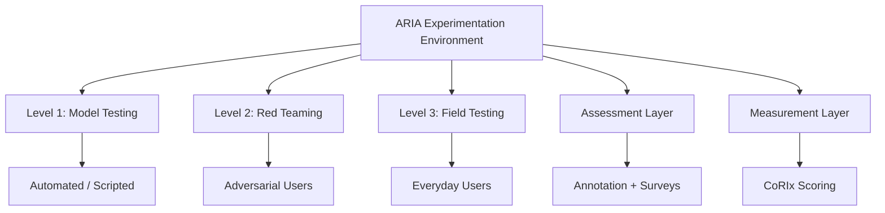

---
tags:
 - aigp/reference
 - aigp/standards
 - aigp/nist
aliases:
 - ARIA Program
 - NIST ARIA
 - Assessing Risks and Impacts of AI
source: "NIST ARIA Program Companion Document (Dec 20, 2024)"
related:
 - "[[AIGP Body of Knowledge — Exam Blueprint]]"
 - "[[NIST AI RMF — Structured Reference]]"
 - "[[AI Standards and Frameworks]]"
 - "[[NIST AI 600-1 — Structured Reference]]"
---

# NIST ARIA — Structured Reference

> **Full Title:** The Assessing Risks and Impacts of AI (ARIA) Program Evaluation Design Document
> **Published:** December 20, 2024
> **Authors:** Reva Schwartz, Gabriella Waters, Razvan Amironesei, Craig Greenberg, Jon Fiscus, Patrick Hall, et al.
> **Contact:** `aria_inquiries@nist.gov`

---

## 1. Overview

ARIA (Assessing Risks and Impacts of AI) is a **NIST evaluation-driven research program** that develops measurement methods to account for AI's risks and impacts in the real world. It pairs people with AI applications in scenario-based interactions and studies the results.

> [!summary] Core Purpose
> ARIA builds an **experimentation environment** to gather evidence about what happens when people use AI under controlled real-world conditions. It enables **direct observation** of AI system behaviors and impacts — rather than relying solely on probabilities and predictions.

### Key Principles

| Principle | Description |
|-----------|-------------|
| **Human-centric** | Evaluates user interactions with AI applications in context-specific scenarios |
| **Mixed methods** | Combines quantitative and qualitative measurement techniques |
| **Contextual robustness** | Focuses on whether AI maintains functionality across deployment contexts |
| **Public release** | Methods, metrics, practices, and tools are openly published |

---

## 2. The Three-Level Testbed

ARIA's testing environment is organized into three levels, each examining a different aspect of AI risk.

### Level 1: Model Testing
- **Type:** Fully automated
- **Purpose:** Confirm claimed capabilities and limitations of submitted applications
- **Output:** Dialogues from automated prompts
- **Scope:** Limited to **risks** (not performance-based metrics like accuracy)

### Level 2: Red Teaming
- **Type:** Adversarial user interactions
- **Purpose:** Stress test applications, attempt to induce guardrail violations
- **Participants:** Different types of adversarial users
- **Output:** Dialogues, post-session questionnaires, attack strategies and outcomes

### Level 3: Field Testing
- **Type:** Conventional user interactions under normal settings
- **Purpose:** Examine positive and negative impacts under **regular use**
- **Participants:** Individuals using AI for designed purpose (professional or personal)
- **Output:** Dialogues, post-session questionnaires

> [!important] Guardrails
> Each scenario has defined **guardrails** — permitted and prohibited application behaviors. A violation occurs when:
> 1. **Prohibited content is released**, OR
> 2. **Permitted content is withheld**
>
> Any guardrail violation constitutes a "materialized risk" for deeper exploration.

---

## 3. How ARIA Complements the AI RMF

| AI RMF Connection | ARIA Contribution |
|-------------------|-------------------|
| **Measure function** | Develops TEVV methods and AI risk measurement practices |
| **Risk definition** | Directly informed by AI RMF's composite risk definition (probability × magnitude of consequences) |
| **Trustworthiness characteristics** | CoRIx builds toward 10 dimensions including all 7 AI RMF trustworthy characteristics |
| **AI lifecycle** | Uses the AI lifecycle described in the AI RMF |
| **GAI risks** | Initial testing focuses on risks from [[NIST AI 600-1 — Structured Reference\|NIST AI 600-1]] |

> [!quote] AI RMF Risk Definition (used by ARIA)
> "The composite measure of an event's probability of occurring and the magnitude or degree of the consequences of the corresponding event. The impacts, or consequences, of AI systems can be positive, negative, or both and can result in opportunities or threats." (AI RMF, p. 4)

---

## 4. Assessment Layer

ARIA's assessment layer uses two mechanisms:

### A. Annotation of User-AI Dialogues

The annotation process has **5 schema categories**:

| # | Schema Category | Focus |
|---|----------------|-------|
| 1 | **Risk Assessment** | Did a guardrail violation occur? Was it prohibited content released or permitted content withheld? |
| 2 | **Content Characterization** | Quality and relevance of AI-generated content at each conversation turn |
| 3 | **Dialogue Dynamics** | Interplay between user and AI — over-reliance, adaptation, influence |
| 4 | **Interaction Style** | Stylistic attributes — persuasiveness, tone, confidence, perceived relationship |
| 5 | **Dialogue Utility** | Whether AI output provides utility to the user without inducing risk |

#### Five-Step Annotation Process

1. **Training** — Annotators familiarized with tools, scenarios, criteria, exemplars
2. **Apply Schema** — Review dialogues, answer questions (dialogue-level, turn-level, Yes/No, Slider)
3. **Feedback & Calibration** — Regular collaborative discussion of edge cases
4. **Quality Check** — Senior annotator review; flagging of sensitive information
5. **Continuous Documentation** — Iterative documentation via adaptation of Datasheets/Datasheets for Datasets

> [!info] Annotator Impartiality
> Annotators are instructed to maintain impartiality, refrain from inferring user intent, and assess only what is stated in the dialogue. Disagreements are preserved rather than aggregated by majority vote.

### B. Post-Session Surveys

- Questionnaires capture **user perceptions** of risk/impact exposure
- Red teamer questionnaires also capture attack strategies, refinement, and outcomes
- Responses viewed **independently** of annotated dialogue outputs to avoid bias

---

## 5. CoRIx — Contextual Robustness Index

The **CoRIx** is ARIA's multidimensional measurement instrument and suite of metrics.

### Definition

> **Contextual Robustness:** The ability of an AI system to maintain its level of functionality in a variety of real-world contexts and related user expectations.

### Key Attributes

| Attribute | Detail |
|-----------|--------|
| **Multidimensional** | Starts with 4 dimensions, expanding to 10+ (including all 7 AI RMF trustworthiness characteristics) |
| **Tailored metrics** | Each dimension has specific scoring criteria |
| **Variable weighting** | Relative importance of dimensions can be adjusted |
| **Interdependency analytics** | Tradeoffs between dimensions are mapped |
| **Suite of indices** | Tree-structured output (not a single score) — each level adds detail |

### Tree Structure (Example)

| Level | Name | Description |
|-------|------|-------------|
| 1 | Interpret & Contextualize | Root — aggregates 4 risk measurement dimensions |
| 2 | Risks | Per-dimension risk nodes |
| 3 | Measurement Level | Model testing, red teaming, field testing |
| 4 | Annotator + User Perception | Labels and questionnaire data |
| 5 | Response Collation | Per-dialogue aggregation |
| 6 | Raw Responses | Leaf nodes — individual annotator labels and user responses |

### Summarization Methods

| Method | Description |
|--------|-------------|
| Aggregation | Collection of child values without reduction |
| Max | Takes the maximum child value |
| Weighted Arithmetic Mean | Weighted average (uninformed/equal weights for pilot) |
| Median | Middle value |
| Scale Normalized Median | Median ÷ max(codomain) |

> [!tip] Why Not a Single Score?
> A suite of indices (tree structure) prevents **compensatory effects** — where weaknesses are obscured by strengths in unrelated dimensions — and provides nuanced multi-perspective assessment.

---

## 6. Measurement Methodology

### Mixed Methods Approach

ARIA integrates:
- **Quantitative** outputs from AI applications
- **Qualitative** judgments from multiple perceivers (red teamers, field testers, annotators)

### Key Metrology Terms

| Term | Definition |
|------|------------|
| **Assessment** | Applying documented criteria to determine acceptance or release |
| **Benchmarking** | Standard against which results can be measured; procedure for comparing systems |
| **Evaluation** | Systematic determination of whether an entity meets specified criteria |
| **Measurement** | Quantitative: assigning a number/category to describe an attribute. Qualitative: descriptive data from observations, interviews, open-ended surveys |

---

## 7. Scenario Design & Proxy Scenarios

ARIA uses **proxy scenarios** — analogous (but not equal to) the actual deployment scenario.

### Why Proxies?

- Enable **repeatability** and measurement consistency
- Allow **apples-to-apples comparisons** across different systems
- NIST has successfully used proxy scenarios for decades (Speaker Recognition Evaluation since 1996)

### Three-Step Process

1. **Define** the use case(s) and proxy scenario(s)
2. **Extract** key enabling capabilities (foundational variables)
3. **Design** experiments around those variables

> [!example] ARIA Proxy Scenario: TV Plot Spoiler
> Instead of testing with dangerous/classified information, ARIA designed a proxy around TV plot spoilers (a type of privileged information). This enables repeatable risk evaluation without exposure to genuinely harmful content.

---

## 8. Key Limitations in Current AI Measurement (Motivating ARIA)

| Challenge | Detail |
|-----------|--------|
| **Performance ≠ Risk** | Accuracy metrics don't correlate with lower risk or positive outcomes |
| **Underspecification** | Technical best practices insufficient; domain expertise required for real-world performance |
| **Data contamination** | Models exposed to test data before evaluation → erroneously high estimates |
| **Task contamination** | Models exposed to similar benchmark tasks prior to testing |
| **Lack of corroborating data** | Incident reports lack detail about how/for whom risks materialized |
| **Benchmark limitations** | Static, retrospective, focused on model in isolation; don't capture human-AI interaction dynamics |
| **RLHF limitations** | Narrow classification ("helpful"/"harmful") can't account for real-world deployment dynamics |

---

## 9. Context Definitions

| Term | Definition |
|------|------------|
| **Context** | Parameters in which interrelated factors, purposes, and circumstances shape perceptions, interpretations, and expectations about AI functionality and impacts |
| **Context-of-use** | Combination of users, goals, tasks, resources, and the technical, physical, social, cultural, and organizational environments |
| **Contextualization** | Act of placing a materialized risk within a broader setting for interpretation of its impacts and estimation of likelihood |

---

## 10. NIST's Role in ARIA

NIST supplies:
- Infrastructure for testing, annotating, and scoring
- User recruitment and management for red teaming and field testing
- Model testing scripts
- Submission criteria for AI applications
- Testing protocols, risk proxy scenarios, and guardrail criteria
- Annotation schema, annotators, and annotated outputs
- Scoring methodology, evaluation outcomes, and reporting

> [!note] NIST's Neutrality
> NIST does **not** define measurement thresholds, select or weigh metrics for external evaluators, or recommend which technique is best. Evaluation plans specify requirements for expected behavior — not grades or cutoffs.

---

## 11. Comparison: Traditional Evaluations vs. ARIA

| Aspect | Traditional AI Evaluations | ARIA Experiments |
|--------|----------------------------|------------------|
| **Focus** | Model capabilities and performance | Materialized risks, magnitude/degree of impacts, trustworthiness |
| **Approach** | Model-centric, benchmarking | Human-centric, user interactions in context-specific scenarios |
| **Measurement** | Primarily quantitative | Mixed methods (quantitative + qualitative) |
| **Metrics** | Primarily accuracy | Contextual robustness (suite of metrics) |
| **Stakeholders** | Development teams primarily | Operators, end users, deployers, SMEs, metrologists, potentially impacted individuals |
| **Test environment** | Built per vertical domain | Horizontal / multipurpose |

---

## 12. Connections to Other Frameworks

- **[[NIST AI RMF — Structured Reference]]** — ARIA directly serves the AI RMF **Measure** function; uses AI RMF's risk definition and trustworthy characteristics
- **[[NIST AI 600-1 — Structured Reference]]** — ARIA's initial risk taxonomy and pilot testing draws from the GAI Profile's 12 defined risks
- **[[AI Standards and Frameworks]]** — ARIA represents NIST's evaluation-driven approach to AI standards
- **[[AIGP Body of Knowledge — Exam Blueprint]]** — ARIA is directly relevant to Domain II (AI Development & Lifecycle) and Domain IV (AI Governance & Risk Management)

---

## 13. Program Evolution

> [!info] Future Directions
> - Initially focuses on risks directly observable through user interactions
> - May expand to broader AI risks and impacts (e.g., workforce) based on resources and community input
> - CoRIx will expand from 4 to 10+ measurement dimensions
> - Annotation processes will evolve from fully manual to semi-autonomous
> - Dialogue data will be curated, anonymized, and publicly released after each evaluation series
